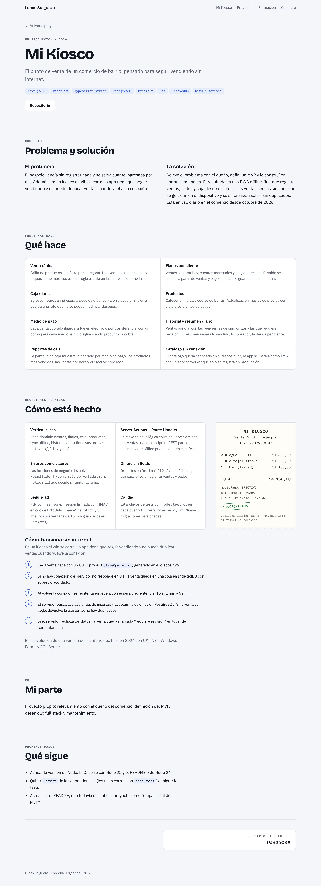

# LucasSalgueroDev

Portafolio de **Lucas Salguero**, desarrollador Full Stack Junior de Córdoba, Argentina.

**Sitio:** <https://lucas-salguero-dev.vercel.app> _(pendiente de publicar en Vercel; ver [Deploy](#deploy))_

El repositorio es parte del portafolio: el contenido está separado del código, las decisiones
de arquitectura están documentadas y cada cambio pasa por CI.

| Home                                                               | Página de proyecto                                                     |
| ------------------------------------------------------------------ | ---------------------------------------------------------------------- |
|  |  |

Más capturas (modo oscuro y celular) en [`docs/screenshots/`](docs/screenshots).

## Qué tiene

- **Home** con el perfil, Mi Kiosco como caso de estudio destacado, el resto de los proyectos,
  formación, habilidades y contacto.
- **Una página por proyecto** en `/proyectos/[slug]`, generada a partir del contenido.
- **Sitio 100 % estático**: no tiene backend, base de datos ni CMS.

## Stack

| Qué       | Con qué                                                          |
| --------- | ---------------------------------------------------------------- |
| Framework | Next.js 15 (App Router) + React 19, con export estático          |
| Lenguaje  | TypeScript en modo `strict`                                      |
| Contenido | Archivos TypeScript en `src/content`, validados con Zod          |
| Estilos   | CSS Modules + tokens en CSS custom properties                    |
| Fuentes   | Bricolage Grotesque, IBM Plex Sans e IBM Plex Mono (`next/font`) |
| Calidad   | ESLint, Prettier, Vitest y GitHub Actions                        |
| Hosting   | Vercel                                                           |

## Cómo correrlo

Necesitás Node.js 22 (la versión está fijada en `.nvmrc`).

```bash
nvm use
npm install
npm run dev
```

El sitio queda en <http://localhost:3000>.

| Script                 | Qué hace                                        |
| ---------------------- | ----------------------------------------------- |
| `npm run dev`          | Servidor de desarrollo                          |
| `npm run build`        | Valida el contenido y genera el sitio en `out/` |
| `npm run start`        | Sirve `out/` en local, igual que en producción  |
| `npm run lint`         | ESLint, incluidas las reglas de arquitectura    |
| `npm run typecheck`    | TypeScript sin emitir archivos                  |
| `npm test`             | Tests con Vitest                                |
| `npm run format`       | Aplica Prettier                                 |
| `npm run format:check` | Verifica el formato sin modificar archivos      |

## Estructura

```text
src/
├─ app/          Rutas: layout, home, /proyectos/[slug], 404, sitemap y robots
├─ components/   Componentes sin datos propios: reciben todo por props
│  ├─ layout/    Header y Footer
│  ├─ sections/  Secciones de la home
│  ├─ project/   Piezas de la tarjeta y de la página de detalle
│  └─ ui/        Botones, chips, ticket y otros componentes chicos
├─ content/      Todos los textos del sitio, como datos tipados
├─ lib/          Esquemas Zod y funciones para leer el contenido
└─ styles/       Tokens de diseño y estilos globales
public/
├─ cv/                      CV en PDF
└─ images/projects/<slug>/  Capturas de cada proyecto
docs/            Arquitectura, guía de contenido y ADRs
```

Las dependencias van en una sola dirección: `app → components → lib → content`.
`npm run lint` falla si un componente importa de `content/`.

## Tareas frecuentes

- **Agregar un proyecto:** crear un archivo en `src/content/projects/` y sumarlo al índice.
  No hace falta tocar componentes. Paso a paso en [docs/CONTENT.md](docs/CONTENT.md).
- **Agregar capturas:** copiar las imágenes a `public/images/projects/<slug>/` y listarlas en
  el campo `images` del proyecto.

## Documentación

- [docs/ARCHITECTURE.md](docs/ARCHITECTURE.md): capas, flujo de datos y por qué es estático.
- [docs/CONTENT.md](docs/CONTENT.md): cómo agregar proyectos y capturas.
- [CONVENTIONS.md](CONVENTIONS.md): nombres, ubicación de archivos y commits.
- Decisiones de arquitectura:
  - [ADR 0001: Next.js con export estático](docs/adr/0001-nextjs-export-estatico.md)
  - [ADR 0002: contenido tipado con Zod](docs/adr/0002-contenido-tipado-con-zod.md)
  - [ADR 0003: CSS Modules y tokens](docs/adr/0003-css-modules-y-tokens.md)

## Deploy

El sitio se publica en Vercel. Al importar el repositorio, Vercel detecta Next.js y, como
`next.config.ts` define `output: "export"`, sirve el contenido de `out/` como archivos estáticos.
No hace falta configurar variables de entorno.

Después del primer deploy hay que poner la URL definitiva en `siteUrl`, dentro de
`src/content/profile.ts`. De ahí salen las URLs canónicas, el sitemap y Open Graph.

## Integración continua

`.github/workflows/ci.yml` corre en cada push y pull request a `main`:
`format:check → lint → typecheck → test → build`, con la versión de Node de `.nvmrc`.
